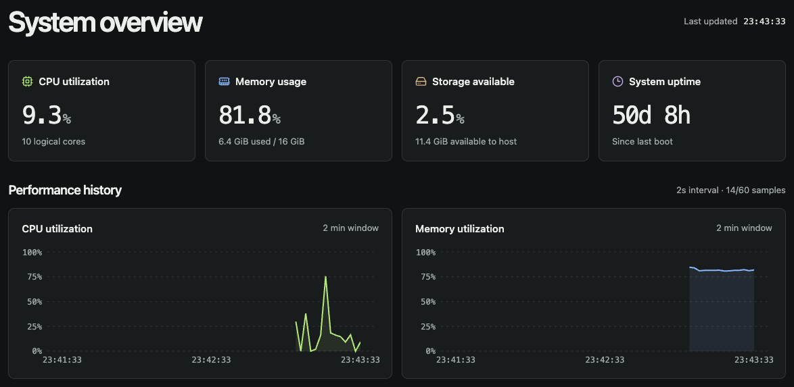

# SystemPulse

SystemPulse is a full-stack dashboard for watching one computer’s CPU, memory, disk usage, and uptime. Python collects real operating-system measurements with psutil, FastAPI serves them as typed JSON, and React plots them as they arrive. **The monitored computer is the one running the backend.** A browser on another device sees that same host.



## How it works

- **Collection.** Each metrics request measures CPU utilization over 100 milliseconds, reads physical memory, and checks the filesystem containing the system root. FastAPI runs the synchronous handler in a worker thread so CPU sampling leaves the event loop available. Uptime comes from the host’s boot timestamp.
- **Delivery.** Pydantic models define the REST responses and generate their OpenAPI schemas. Timestamps use UTC, capacities use bytes, and unavailable CPU hardware details serialize as `null`.
- **Display.** A React hook polls roughly every two seconds and retains the last 60 successful samples. The responsive dashboard pairs current values with CPU and memory charts, disk capacity, boot time, and the last successful update.
- **Recovery.** Only one polling cycle runs at a time. Hiding the tab cancels the current request and pauses polling. Returning resumes it immediately. Failed polls retain the last snapshot, show its connection state, and retry automatically. Requests have a five-second deadline.

## Repository guide

| Path | Responsibility |
|---|---|
| `backend/app/services/metrics.py` | Host measurements and handling of unavailable readings |
| `backend/app/api/`, `backend/app/models/` | FastAPI routes and Pydantic response contracts |
| `backend/app/main.py` | Application setup, allowed origins, and collection-error responses |
| `frontend/src/services/`, `types/`, `hooks/` | TypeScript API client, response types, and polling lifecycle |
| `frontend/src/App.tsx`, `components/`, `utils/` | Dashboard layout, reusable cards and Recharts plots, and unit formatting |
| `backend/tests/`, `frontend/src/**/*.test.*` | Pytest/HTTPX and Vitest/React Testing Library suites |

The backend runs on Uvicorn. The frontend uses React, strict TypeScript, Vite, Tailwind CSS, Recharts, and Lucide icons.

## Run locally

Install Python 3.12 or newer and Node.js 22.12 or newer with npm. The commands below use a POSIX shell. Start each terminal in the repository root.

**Terminal 1 — backend**

```sh
cd backend
python3 -m venv .venv
. .venv/bin/activate
python -m pip install -r requirements.txt
uvicorn app.main:app --host 127.0.0.1 --port 8000
```

**Terminal 2 — frontend**

```sh
cd frontend
npm ci
npm run dev -- --strictPort
```

Open [the dashboard](http://localhost:5173) using the exact hostname shown here so it matches the default CORS origin. For a quick recovery demo, stop Uvicorn, watch the last successful readings stay visible, then restart it in Terminal 1.

The defaults work without environment files. To use another origin, export `CORS_ORIGINS` as a comma-separated list before starting Uvicorn. To change the API address, copy `frontend/.env.example` to `frontend/.env.local`, edit `VITE_API_BASE_URL` (including the `/api` suffix), and restart Vite.

## REST API

| Method and path | Successful JSON response |
|---|---|
| `GET /api/health` | `{"status":"ok"}` confirms the backend is responding. |
| `GET /api/system` | Hostname, OS name, uptime in seconds, boot and measurement timestamps, and CPU hardware details. |
| `GET /api/metrics` | Timestamped CPU utilization, physical memory used and available, root-volume space used and free, and utilization percentages. |

**Storage accounting.** The dashboard shows available space as `100 × free_bytes / total_bytes`. The root volume’s used bytes are a separate measurement. On macOS APFS, the system volume and its siblings share a container. For the boot volume, psutil can report container capacity and available space alongside bytes consumed by the system volume alone. Other volumes (including Data, Preboot, and VM) also consume capacity. On POSIX, the API’s `utilization_percent` follows psutil’s volume accounting, `100 × used_bytes / (used_bytes + free_bytes)`. Compare the root mount with `df -k /` and, on macOS, `diskutil info /` and `diskutil apfs list`. The dashboard uses binary GiB while diskutil also prints decimal GB.

A required measurement failure returns HTTP 503 with a JSON `detail` message. To inspect every field or run a request, open the running backend’s [interactive API documentation](http://127.0.0.1:8000/docs).

## Validation

Run the backend checks from `backend/` with the virtual environment active.

```sh
pytest
ruff check .
```

Run the frontend checks from `frontend/`.

```sh
npm test -- --run
npm run lint
npm run build
```

The 17 backend tests cover response contracts, collection failures, uptime, optional hardware, and CORS. The 14 frontend tests exercise rendering, chart data, formatting, API requests, cancellation, recovery, and bounded polling history using mocks and controlled timers. The production build also checks TypeScript.

## Limitations and future work

Each tab keeps its own history in memory, so refreshing starts a new chart. Disk figures cover one filesystem. Hardware detail varies by OS and device. The API defaults to loopback and has no authentication. Live verification covered macOS and desktop and mobile viewport sizes in Chrome.

Three possible next steps:

1. Run the regression suites on Linux and Windows in GitHub Actions.
2. Automate the browser smoke check that stops and restarts the backend and verifies dashboard recovery.
3. Add optional per-core CPU readings to help identify workloads concentrated on one core.

SystemPulse is released under the [MIT License](LICENSE).
